# acidulous

acidulous is a [norns](https://monome.org/docs/norns/) patch player based on the full app [Acidulous](https://github.com/roge-rm/Acidulous). 

The full engine has been ported to the norns platform so patches will sound the same as they did when created on the app. 
All of the app's presets are included and patches and songs exported from the full app can be imported on the norns.

Play one machine at a time via an attached MIDI/USB device, MPE included, or configure up to 16 machines at once to drive multitimbrally from an external source.
Use the knobs on the norns to change patches live and save the results as new patches.

I've tested it extensively on my [shieldXL](https://github.com/okyeron/shieldXL) with a Pi 4 2GB, it should run well on a Pi 3 as well but you won't be able to run
as many machines at the same time.

If you'd like to talk about this please come talk to me in the #acidulous channel [on my discord](https://discord.gg/9Wun47jGC6).

Enjoy! 
Dan

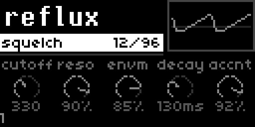

---

- [What you need](#what-you-need)
- [Installing](#installing)
- [On the norns](#on-the-norns)
- [Parts and MIDI](#parts-and-midi)
- [MPE](#mpe)
- [OMX-27](#omx-27)
- [Machines](#machines)
- [Samples](#samples)
- [Saving](#saving)
- [Credits](#credits)

## What you need

- A [norns](https://monome.org/docs/norns/) or [norns shield](https://github.com/okyeron/shieldXL).
- A USB MIDI keyboard or sequencer.
- Optional: an [OMX-27](https://github.com/okyeron/OMX-27) with [Quixotic7's firmware](https://github.com/Quixotic7/OMX-27) 1.15.4 or newer.
  With older firmware, acidulous offers an update: K3 updates and K2 skips. Updating clears the OMX-27's saved patterns. On a Teensy unit, press the Teensy's button if asked. To update or repair it later, choose update OMX-27 under PARAMETERS > EDIT. If you skip, the OMX-27 plays as a plain MIDI keyboard.
- Optional: an MPE controller, like an Exquis or QuNexus.

## Installing

1. Over ssh, `git clone https://github.com/roge-rm/acidulous-norns ~/dust/code/acidulous`. The folder name makes it show as acidulous in **SELECT**.
2. Load it from **SELECT**.
3. The first time, it installs its SuperCollider plugin and restarts SuperCollider, which takes about 20 seconds.

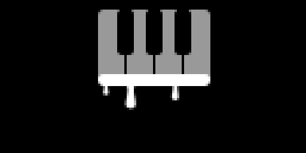

To update, press **update** in maiden and load it again. If the plugin changed it gets installed the same way.

If SuperCollider won't start after you've been logged in over ssh, restart the norns.

## On the norns

Hold **K1** and turn **E1** to change pages: play, parts, card, mixer, sends and song. Holding **K1** gives fine steps when changing values.

### Play

The selected part's machine, patch and five macros, with a little picture of the machine that moves as it plays. The bottom line has the part, the MPE and keys marks, the part's scale and the load when it's busy.

- **E1** machine, **E2** patch or a macro, **E3** changes it.
- **K2** patches, **K1** + **K2** machines, **K3** plays a note.

| | |
|---|---|
| 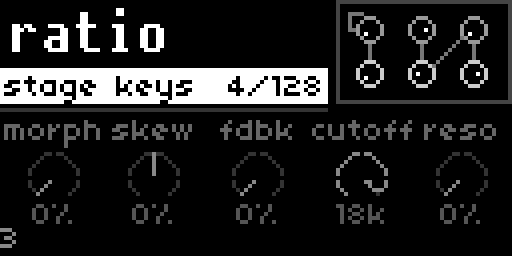 Ratio's six operators | 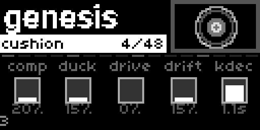 Genesis's kick drum |
| 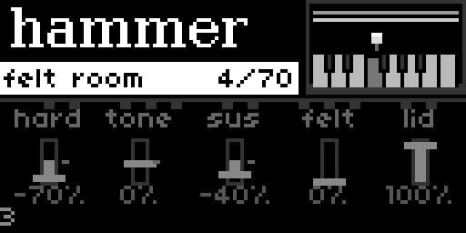 Hammer's piano | 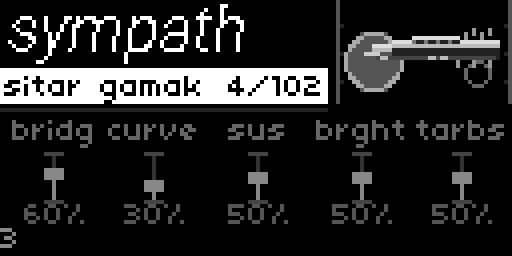 Sympath's sitar |
| 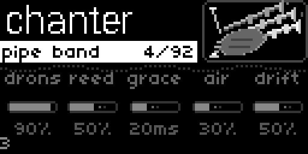 Chanter's bagpipe | 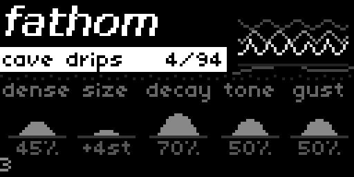 Fathom's waves |

- Each machine has its own little picture. Aviary's bird opens its beak and sings, Genesis's kick drum pushes out on each hit, Hammer's hammer strikes the string and Brazen's valves go down.
- Chanter's bag swells as it plays, Sympath's strings shake and Fathom's waves rise.
- Left alone they still move a little: the bird blinks, a glint goes round the drum's rim and one of Tine's tines hums.
- Each group has its own look, with its own font for the name and its own way of drawing the macros.

### Parts

Each part's machine, patch and meter.

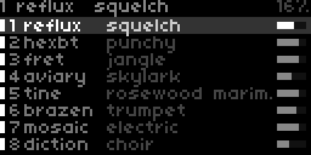

| | |
|---|---|
| **E1** | part |
| **E2** | patch |
| **K1** + **E2** | machine |
| **E3** | volume |
| **K2** | patch list |
| **K1** + **K2** | machine picker, or the saved presets on an effect or mods card |
| **K3** | play a note |
| **K1** + **K3** | load samples, or the scope on a Nexus part |

In the patch list and machine picker, **E1** changes tab, **E2** moves, **K3** loads and **K2** closes. Loading the patch you're on again resets it.

| | |
|---|---|
| 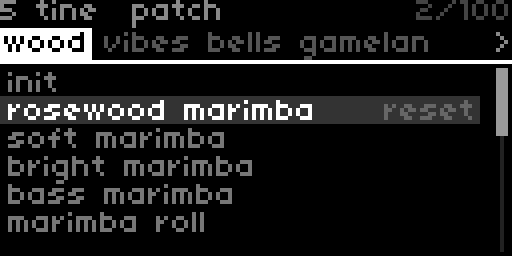 Tine's patches by family | 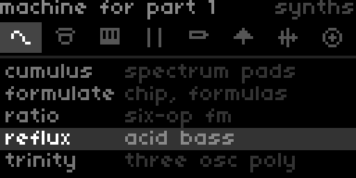 The machine picker |

### Cards

The machine's controls, grouped as in the app. **E1** card, **E2** control, **E3** value, **K2** back to play. **K1** + **E2** right jumps to the amp envelope and left back.

| | |
|---|---|
| 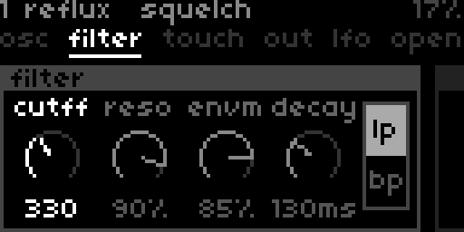 Reflux's filter card | 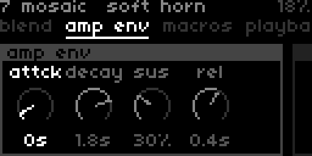 Mosaic's amp envelope |

After the machine's cards come the effects. A patch's own effects go in inserts 1 and 2, and fx 3 and 4 on the inserts card are yours, kept when you change patch or machine. Each effect has a mod card with a source (LFO, steps, follow or another track) and up to two knobs to move. A Venue's room knob picks one of the app's five rooms, or **K1** + **K3** for an impulse file.

The mods card has three slots for Scale, Chord and Arp, played in that order. Scale and Chord share a key and scale. They stay when you change patch or machine.

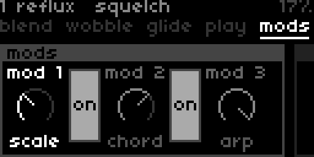

The arp, synced LFOs and delay follow the norns clock.

Pan and anything else that crosses zero stops in the centre for three detents.

### Mixer and sends

A meter, fader and pan for each part, with mute and solo, then out with the master level and limiter. Loudness in LUFS is at the top right.

| | |
|---|---|
| 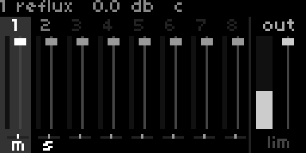 The mixer | 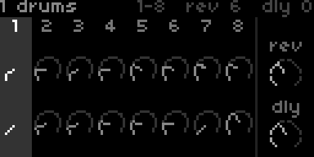 Sends, with Squelch loaded |

| Mixer | |
|---|---|
| **E1** | part, or out after the last one |
| **E2** | pan |
| **E3** | level |
| **K2** | mute |
| **K3** | solo |

| Sends | |
|---|---|
| **E1** | part, or out after the last one |
| **E2** | reverb send, or reverb size on out |
| **E3** | delay send, or delay feedback on out |

On out, hold **K1** for the reverb's model and the delay's mode. The rest of their settings are in **PARAMETERS > EDIT**. Delay time is in notes.

### Songs

Plays songs exported from the app as a zip. Put them in dust/data/acidulous/songs, or anywhere in dust/audio. Loading one replaces the parts with its tracks until you unload it.

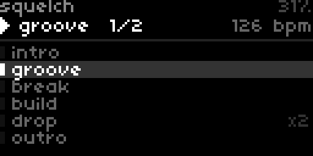

| Song | |
|---|---|
| **K1** + **K2** | song list (**K3** loads, none unloads) |
| **K2** | play or stop |
| **E2** | scene |
| **K3** | play from that scene, or queue it next |

The norns clock follows the song's tempo. Track 1 plays from channel 1 and so on, and the other pages work on the tracks. Edits to a song stay until you unload it and don't save into the song. Unloading puts your own parts, sends and tempo back. A PSET saves your own parts and which song was loaded.

### Scope and settings

The Nexus scope shows its modules and what the selected one puts out. **E2** module, **K3** plays a note, **K2** closes.

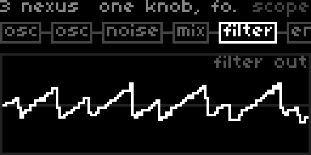

Every part's settings are in **PARAMETERS > EDIT**. After three minutes with nothing played, the screensaver comes on; set **screensaver after** to change it.

## Parts and MIDI

Part 1 listens on channel 1, part 2 on channel 2 and so on. Change it with the part's **channel**, or **off** to silence it.

**parts** is 8 or 16. With 16 the pages show 8 at a time, turn **E1** past part 8 for the rest. More parts use more CPU.

**midi from** picks the MIDI device, or **all**.

## MPE

Plug in an MPE controller and play. The selected part gets every channel of it, with per-note bend, pressure and timbre, and shows three little bars on the parts page.

- **mpe part**: **follow** for the selected part, a part number to keep it on one, or **off**.
- **mpe from**: **auto** finds an Exquis, a QuNexus or anything that plays like MPE. Otherwise pick its port.
- **mpe bend**: the bend range, 48 by default, 2 for a QuNexus. It's set by itself if the controller sends its range.

Both zones work.

## OMX-27

Plug it in by USB and it goes into REMOTE mode.

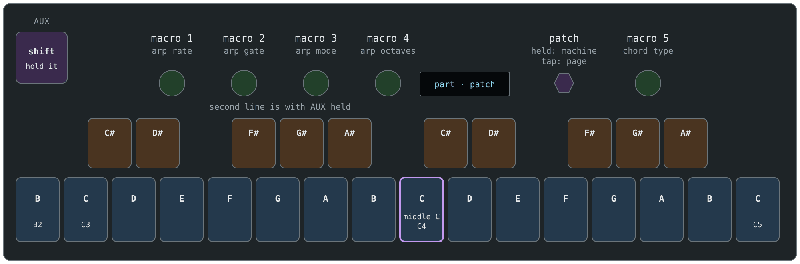

- The keys play the selected part, and the encoder picks the patch. Hold and turn it for the machine, tap it to swap the parts and card pages.
- The five pots are the macros. A pot takes over once it passes the macro's value.
- **AUX** + top left keys: octave down and up.
- **AUX** + the first 8 bottom keys: parts 1 to 8, or 9 to 16. **AUX** + the 9th switches between them.
- **AUX** + top keys 3 to 6: scale, chord, arp and latch on and off.
- Hold **AUX** + key 3: keys pick the root, the encoder the scale, and a tap swaps snap and degree.
- Hold **AUX** + key 4: the encoder picks the chord.
- With **AUX** held the pots are the arp's rate, gate, mode and octaves and the chord type.

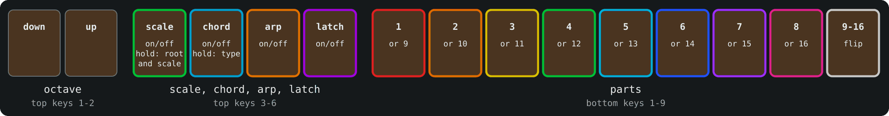

**omx velocity** in **PARAMETERS > EDIT** sets how hard the keys play.

## Machines

In the picker's order. Parts is about how many can play at once on a Pi 4. Mixing machines adds up, so a Trinity or Ratio leaves less room for the rest. The measurements are in [docs/machines.md](docs/machines.md).

| | Machine | What it does | Parts |
|---|---|---|---|
| synths | Cumulus | Pads made from a spectrum of partials | 4 |
| | Divisi | Strings, choir and brass ensemble | |
| | Formulate | 8-bit chip synth with formula waves | 8 |
| | Ratio | Six-operator FM | 2 |
| | Reflux | Acid bass | 8 |
| | Trinity | Three oscillators with wavetables and FM | 2 |
| drums | Dice | Loop slicer | 8 |
| | Forage | Sample drums, 13 pads | 8 |
| | Genesis | Modelled drum machine | 8 |
| | Hexbeat | 13 synth drums | 8 |
| | Palm | Hand drums, hold a note for a pattern | 8 |
| | Resonance | Struck objects | 8 |
| keys | Hammer | Pianos and electric pianos | 5 |
| | Manual | Organ with a rotary cabinet | 5 |
| | Tine | Bars, tines, pans and bells | 8 |
| strings | Filament | Plucked, bowed and hammered strings | 5 |
| | Fret | Guitars and basses with an amp | 8 |
| | Sympath | Sitar, tanpura and the like | 6 |
| winds | Brazen | Brass | 8 |
| | Chanter | Bagpipes and hurdy-gurdy | 8 |
| | Draw | Harmonicas and accordions | 8 |
| | Timber | Woodwinds | 8 |
| | Tongue | Jaw harp | 8 |
| nature | Aviary | Birdsong | 8 |
| | Fathom | Water and weather | 8 |
| samples | Molt | Sings a take at the notes you play | 8 |
| | Mosaic | SoundFonts and multisamples | 4 |
| | Pollen | Grains from a file or the input | 2 to 4 |
| beyond | Bias | Audio tracks, in songs only | |
| | Cipher | Vocoder | 5 |
| | Diction | Vocal synth | 8 |
| | Nexus | Modular, built from the other machines | 1 to 2 |

- Divisi isn't counted yet. One part of Everything, its heaviest patch, takes about 15%.
- Diction sings a vowel with its built-in voice, picked with the vowel macro.
- Nexus's Listening, Talking and Sing to the Piano play the norns input, so they're silent without one.
- Changing Cumulus's spectrum params (partials to bodd) rebuilds its sound and cuts held notes, so none of them are macros.

## Samples

Forage, Mosaic, Dice, Pollen and Molt play samples. On one of those parts press **K1** + **K3** for the file list, in dust/audio and on a USB stick if one's in. Each starts with a sound of its own when you pick it.

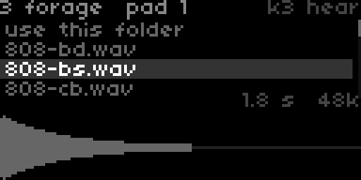

| | |
|---|---|
| **E2** | move |
| **K3** | open a folder, or hear the file |
| **K1** + **K3** | load it |
| **K2** | back |

- **Forage**: **E3** picks the pad, and it moves on after each file so you can build a kit. **use this folder** loads the first 13 files.
- **Mosaic**: an .sf2 and one of its presets, or **use this folder** on a folder of WAVs. A note in the file name, like `piano C4.wav`, puts it on that note.
- **Dice**, **Pollen** and **Molt** take one file. Pollen with none, or **live input**, plays the norns input.

WAV, AIFF and FLAC, up to 30 seconds except on Mosaic. All parts together can hold 320 MB, 64 MB per SoundFont. Files from USB are copied to dust/audio/acidulous/usb.

## Saving

PSETs save each part's machine, patch, edits and samples. The samples aren't copied, so keep them where they were.

To save a part's sound as a patch, press **K1** + **K3** in the patch list and type a name. It goes in a **saved** tab at the start of the list, and the app can open it too. **K1** + **K3** on a saved one deletes it.

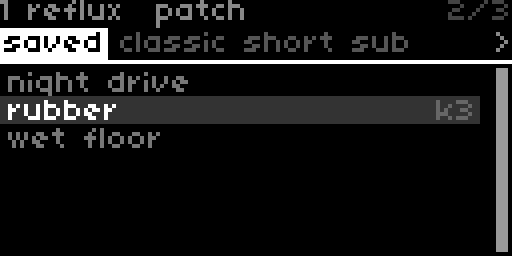

Presets from the app (.acpreset) go in dust/data/acidulous/presets, or load one from the file list with **K1** + **K3**. Their samples are unpacked to dust/audio/acidulous/presets and deleted with the preset, unless something still uses them.

Effect and modifier presets work the same way: **K1** + **K2** on an effect or mods card for the list, **K3** loads, **K1** + **K3** saves or deletes.

## Credits

acidulous is GPL-3.0, see [LICENSE](LICENSE). The engine in `third_party/acidulous` is from the Acidulous app, see [its README](third_party/acidulous/README.md).

The OMX-27 is by Denki Oto, with firmware by okyeron and Quixotic7.

Building the plugin is in [docs/building.md](docs/building.md).
